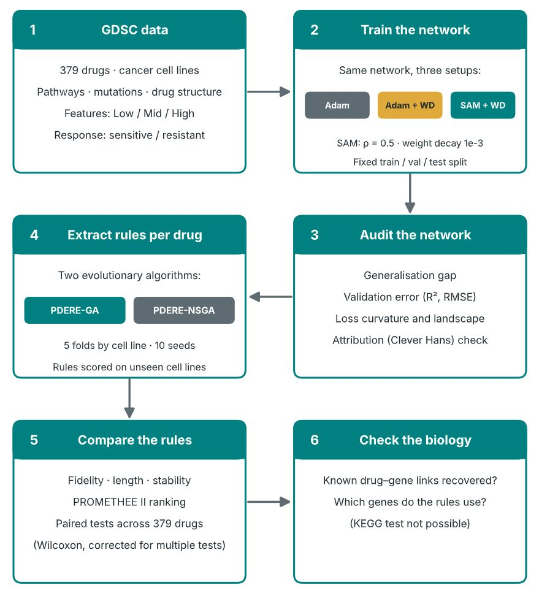
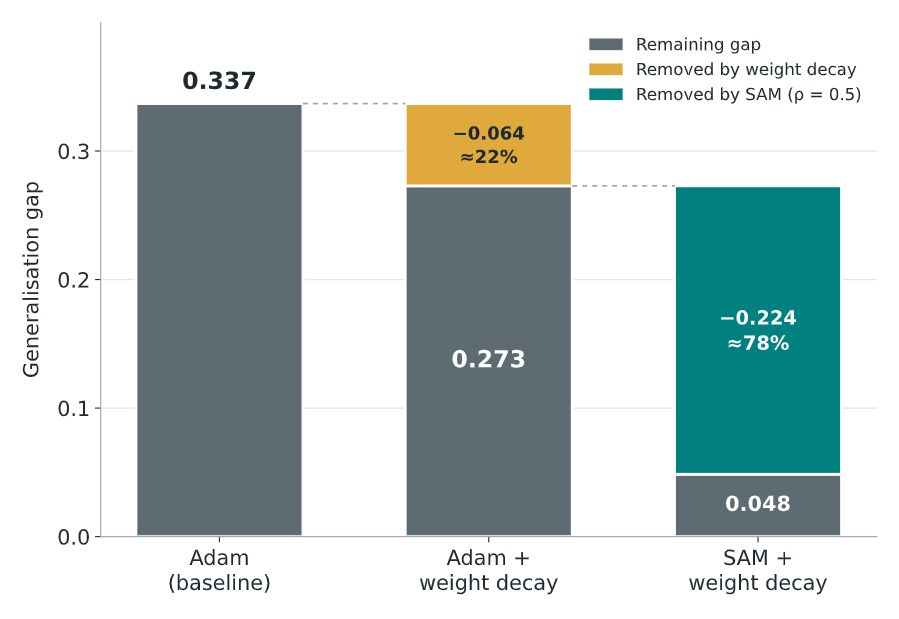
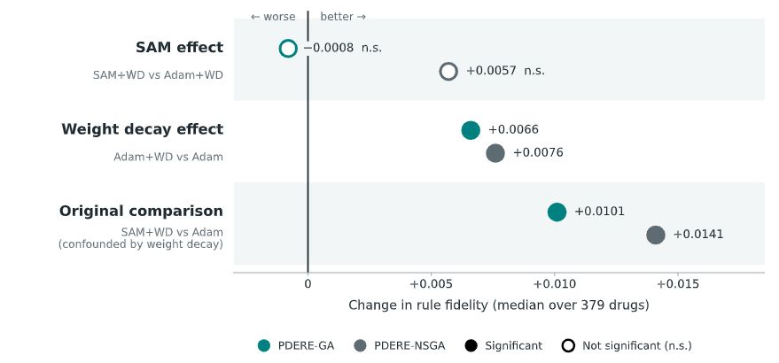
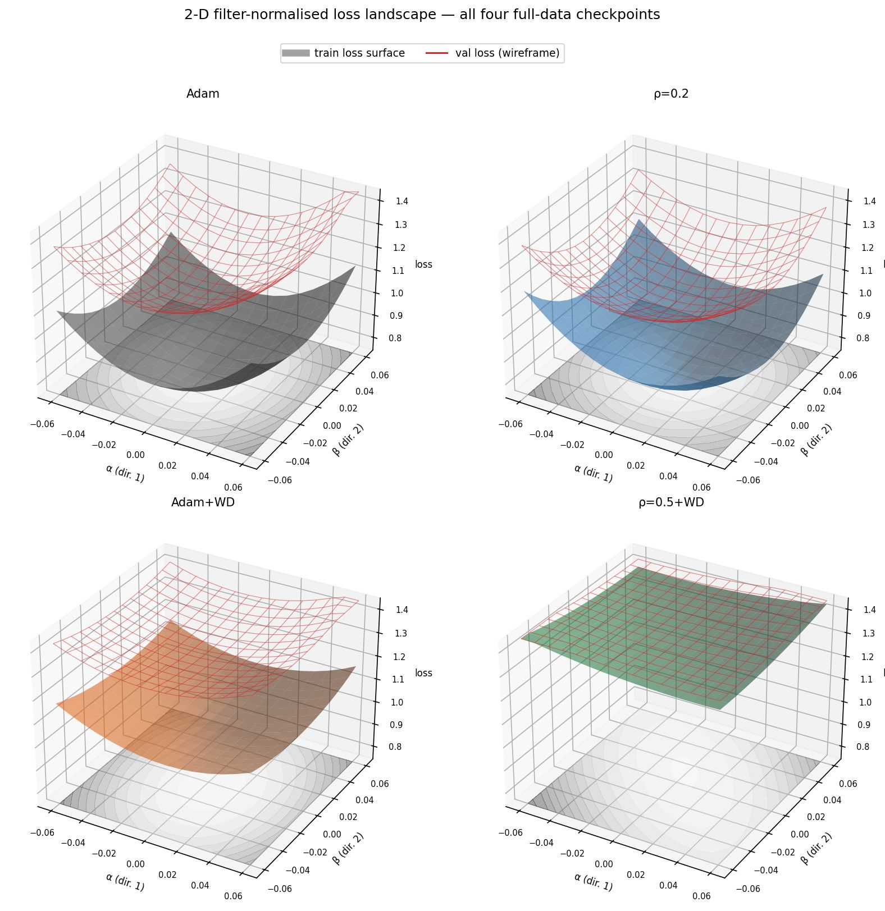
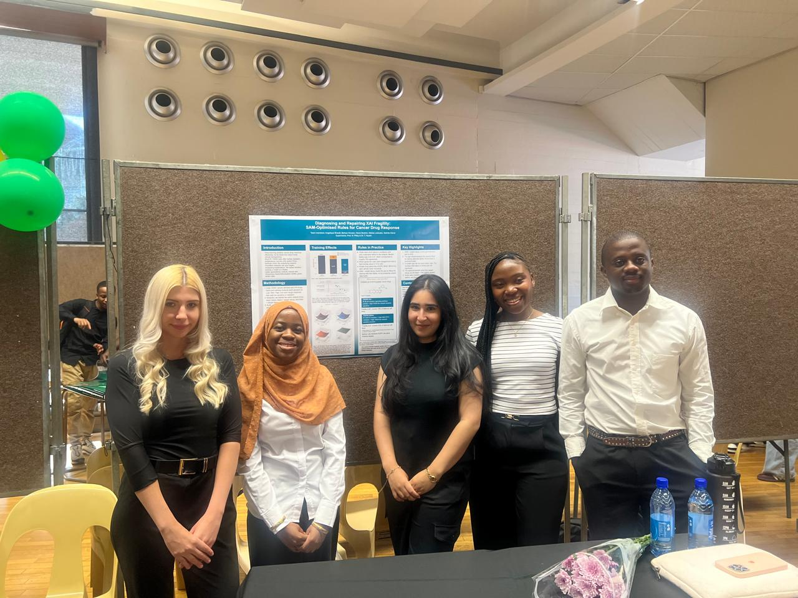
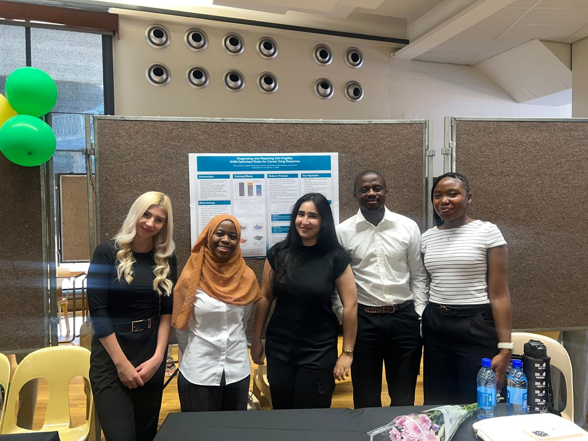
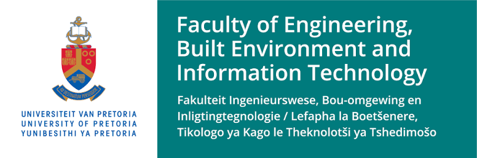

# Diagnosing and Repairing XAI Fragility: SAM-Optimised Rules for Cancer Drug Response

COS700 Honours research project, Department of Computer Science, University of Pretoria (2026).

Deep neural networks predict how cancer cells respond to drugs, but they are black boxes. Short IF-THEN rules extracted from a network can explain it, but only if the network itself is sound. We tested whether training the network with **Sharpness-Aware Minimisation (SAM)**, which steers training toward flatter minima and a smaller generalisation gap, produces better rules.



## What we did

- Trained the **DeepCCDS** drug-response network on **GDSC** data in three ways: Adam (baseline), Adam with weight decay, and SAM with weight decay (rho = 0.5).
- Built **PDERE** (Per Drug Evolutionary Rule Extraction), in a genetic-algorithm variant (PDERE-GA) and an NSGA-II variant (PDERE-NSGA), and extracted rules separately for **379 drugs** from each network.
- Scored every rule on held-out cell lines (5 folds by cell line, 10 seeds) for fidelity, length and stability, ranked rules with PROMETHEE II, and compared the networks with paired Wilcoxon tests across the 379 drugs, corrected for multiple testing.

## Main findings

1. **SAM + weight decay cut the generalisation gap by 86%** (0.337 to 0.048). Weight decay accounts for about 22% of that reduction and SAM for about 78%.

   

2. **The gap closed because the network fitted its training data less tightly, not because it predicted better.** Validation RMSE rose from 1.030 to 1.072 and validation R-squared fell from 0.857 to 0.844.
3. **A smaller gap did not give better rules.** Median held-out fidelity was 0.43 to 0.47 for every network. The isolated SAM effect (SAM+WD against Adam+WD) was not detectable for fidelity, stability or PDERE-GA rule length. The apparent SAM benefit in the combined comparison comes from weight decay.

   

4. **Rules were short (about two conditions) and only moderately faithful.** The genes they used changed from fold to fold, and known drug-gene links (EGFR, BRAF, BRCA1/2) were almost never recovered.
5. **Conclusion:** training metrics such as the generalisation gap are poor proxies for explanation quality, so explanations need to be audited directly. With one network per condition this is a null result under a limited design, not evidence that SAM cannot help.

### Loss landscapes of the four trained networks

The solid surface is training loss and the red wireframe is validation loss; the vertical distance between them is the generalisation gap. Adam has a deep bowl with a large gap, weight decay flattens it, and SAM with rho = 0.5 plus weight decay is the flattest, with the two surfaces nearly coinciding. The rho = 0.2 panel is an earlier SAM network without weight decay.



### What a rule looks like: Erlotinib

Erlotinib is an EGFR-targeted cancer drug. These are example rules from the SAM + weight decay network (one cross-validation fold). Each describes when the network predicts sensitivity.

> **PDERE-GA:** IF *B-cell receptor signalling pathway activity = High* THEN the network predicts *sensitive*
> Fidelity 0.48 (ceiling 0.5). Covers 19% of held-out cell lines.
>
> **PDERE-NSGA:** IF *CNOT3 mutation = High* AND *ETV1 mutation = High* THEN the network predicts *sensitive*
> Fidelity 0.41. Covers 12% of held-out cell lines.

Neither rule mentions EGFR, the gene Erlotinib targets. Rules are approximations of the network, not clinical findings. A rule that predicts one class scores at most 0.5 when the cell lines it covers are mixed.

*This project presents research results only. It is not medical advice and must not be used to choose or change treatment.*

## Repository layout

| Path | What it holds |
|---|---|
| `src/` | Core code: data (`data/`), DeepCCDS and SAM training (`model/`), PDERE-GA and PDERE-NSGA extraction (`extraction/`), per-drug pipeline (`per_drug/`), shared utilities (`common/`), and the analysis scripts behind the report figures (`investigations/`) |
| `scripts/` | Command-line tools: verify and compare result cells, and generate the final-run figures |
| `configs/` | Run configurations and the expected file hashes used to check results |
| `tests/` | Unit tests |
| `artifacts/` | Trained networks (`checkpoints/`), processed data, and the final-run analysis tables and provenance (`per_drug/`) |
| `data/` | Input data. The processed data for rule extraction is in `processed/real_extraction/`; the raw DeepCCDS CSVs are not in the repository (see Getting started) |
| `docs/` | The original research proposal and the README images |
| `appendix/` | Supporting experiments cited in the report appendix: the SAM parameter sweep, the global (all-drug) extraction runs and the pilot study. Self-contained: run its scripts from inside `appendix/` |
| `archive/` | Earlier and superseded material, kept for the record |

## Getting started

**Install.** The code was developed on Python 3.13; no minimum version is pinned.

```bash
python3 -m venv .venv
source .venv/bin/activate          # Windows: .venv\Scripts\activate
pip install -r requirements.txt
# optional, CPU-only PyTorch:
pip install torch --index-url https://download.pytorch.org/whl/cpu
```

**Run the tests.** The tests build their own small data, so nothing needs downloading.

```bash
pytest tests/ -v
```

**What a fresh clone can do.** The repository holds the four trained networks (`model.pt`), the processed data and predictions needed for rule extraction, and the final-run summary tables. It does not hold the 11,370 final result cells (they are on Google Drive, see below) or the raw DeepCCDS input files.

- **Re-run rule extraction.** `src/per_drug/run.py` is a resumable driver. It checks 14 input files against `configs/expected_hashes.json` and refuses to start if any differ.
  ```bash
  python -m src.per_drug.run --out-root <output folder> --n-seeds 10 --drugs-from configs/pilot2_drugs_379.json
  ```
  The full 379-drug run is compute-heavy; use `--drugs` to run a subset.
- **Check a set of results.** Download the cells from Drive, then:
  ```bash
  python scripts/verify_cells.py --out-root <folder containing cells/>
  ```
- **Compute the statistics.** `python -m src.per_drug.analyse --root <folder containing cells/>` produces the paired tests and tables (needs the cells from Drive).
- **Regenerate the final-run figures.**
  ```bash
  python scripts/make_final_figures.py --in-dir artifacts/per_drug/final_results --out-dir <figure folder>
  ```
- **Preprocess and retrain the networks.** `src/data/preprocess.py`, `src/model/baseline.py` and `src/model/sam.py` need the DeepCCDS authors' precomputed CSVs in `data/deepccds_precomputed/` ([hanjunwei-lab/DeepCCDS](https://github.com/hanjunwei-lab/DeepCCDS)). Training the SAM network took about 13 hours on a CPU.

Run scripts from the repository root, except those under `appendix/`, which must be run from inside `appendix/`.

## Results and data

The full per-drug results (11,370 cells: 379 drugs x 3 networks x 2 extractors x 5 folds, 10 seeds each) and the global rule pools are too large for the repository and are on Google Drive:

- Final per-drug results: [IMPLEMENTATION RESULTS](https://drive.google.com/drive/folders/1r2K4c7u7ZsTzoDJJyu5Zcn7jfbEKqWRw?usp=sharing)
- Global rule pools, SAM investigation results, saved networks and data matrices: [shared results folder](https://drive.google.com/drive/folders/1W66iGDV2aVTdNgeHtZOS53-qxIlfp0WP?usp=sharing)


## Team


<!--  -->

| Name | Contact |
|---|---|
| Angelique Breedt | u23542838@tuks.co.za |
| Bahiya Hoosen | u22598546@tuks.co.za |
| Hawa Ibrahim | u20418494@tuks.co.za |
| Melisa Ledwaba | u19296950@tuks.co.za |
| Sakhile Manzi | u26838002@tuks.co.za |

**Supervisors:** Prof. Nelishia Pillay and Dr. Thambo Nyathi

Department of Computer Science, Faculty of Engineering, Built Environment and Information Technology, University of Pretoria.

