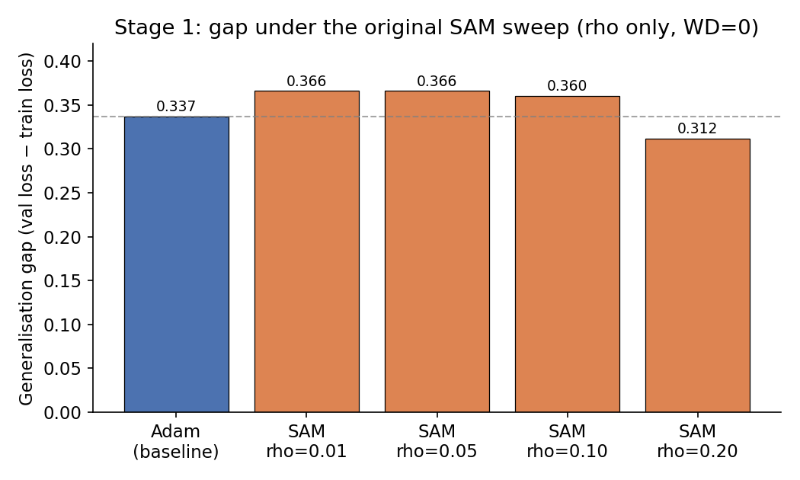
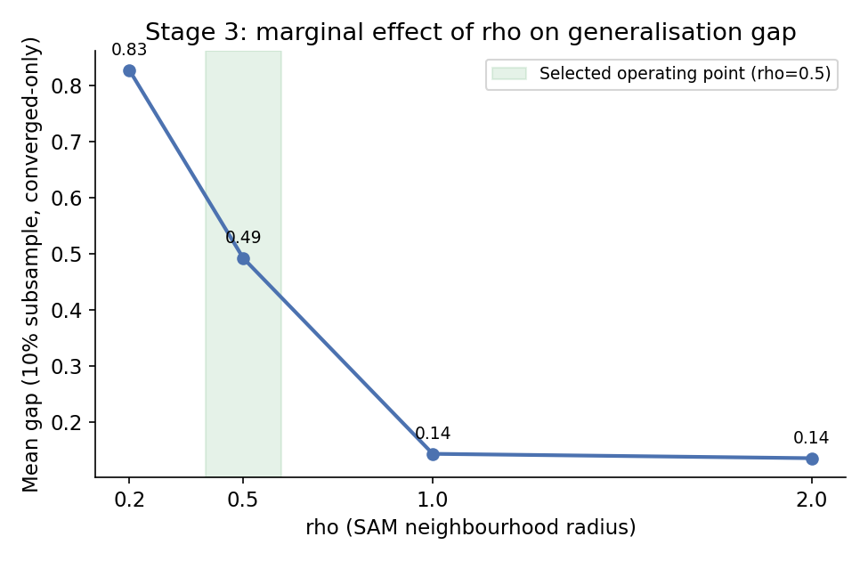
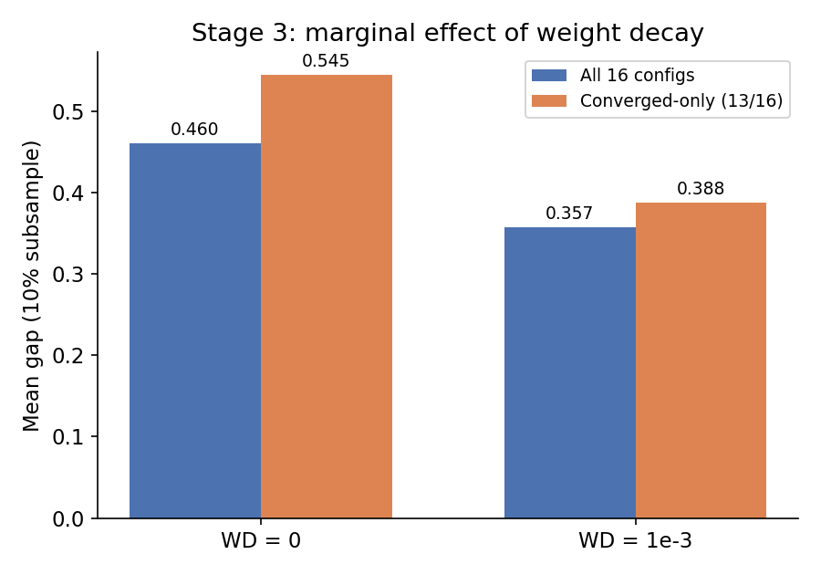
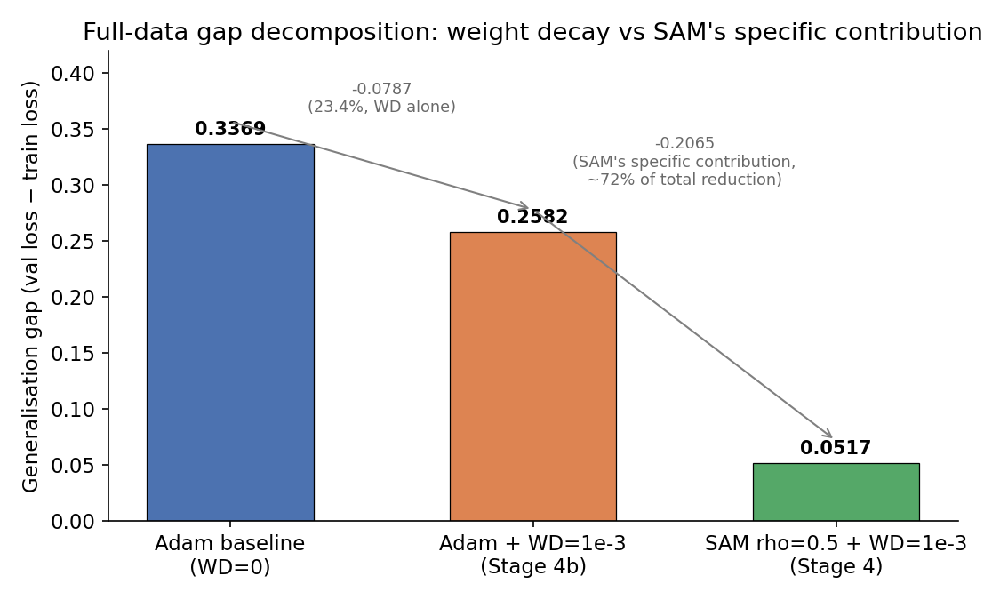
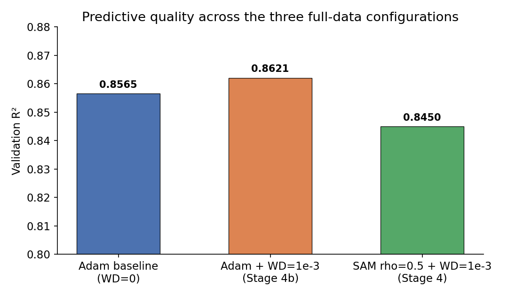

# SAM Generalisation Gap Investigation — Full Technical Report

**Project:** Diagnosing and Repairing XAI Fragility: SAM-Optimised Rules for Cancer Drug Response
**Team:** Angelique Breedt, Hawa Ibrahim (group lead), Bahiya Hoosen, Sakhile Manzi, Melisa Ledwaba
**Supervisors:** Prof. Nelishia Pillay, Dr. Nyathi Thambo (NICOG)
**Document purpose:** A complete, self-contained account of the SAM generalisation-gap investigation, from motivation through to the present state, written to be readable on its own and to support both the 14 September progress presentation and the internal record required for examiner scrutiny.

---

## 1. Why this investigation happened

### 1.1 The project's core thesis

The project's central claim is that improving a neural network's generalisation gap through Sharpness-Aware Minimisation (SAM) produces higher-quality symbolic IF-THEN rules when those rules are extracted by evolutionary algorithms (a genetic algorithm and NSGA-II) from the trained network. This is framed as a "Red XAI" contribution: rather than proposing a new explanation method, the project audits and stress-tests an existing pipeline (DeepCCDS plus rule-based explanation) to determine whether an intervention aimed purely at training geometry, with no reference to explanations at all, has a measurable downstream effect on explanation quality.

The novelty argument rests specifically on SAM being **explanation-agnostic**. SAM does not know that rule extraction will later be performed on the model it trains; it only minimises a sharpness-aware loss. If rule quality improves as a result, that improvement is an emergent by-product of geometric regularisation, not a designed objective — which distinguishes this project's approach from explanation-guided training methods (such as R2ET, REGEX, and EGEM) that embed explanation objectives directly into the loss function. This distinction is only defensible if the SAM intervention's effect can be isolated from confounds that are not SAM-specific — a point that becomes directly relevant later in this report (Section 5).

### 1.2 Why the generalisation gap specifically

The project's reasoning chain runs: **sharper minima → less stable, less generalisable models → rule extraction on an unstable model produces rules that fit noise rather than genuine biological signal.** Li et al. demonstrate that neural networks can converge to either sharp or flat regions of the loss surface, that sharp minima are highly sensitive to small parameter perturbations, and that flat minima are associated with improved generalisation. Dombrowski et al. separately show that explanation methods are sensitive to the geometry of a model's decision boundary, with smoother boundaries producing more stable attributions. The generalisation gap (validation loss minus training loss) is the most direct, measurable proxy for "how sharp is this model's overfitting behaviour" available without computing the full Hessian spectrum, which is why it was chosen as the quantity to track throughout this investigation.

### 1.3 The triggering observation

Early in the project, Angelique's Adam baseline and Bahiya's first SAM runs (ρ = 0.01, 0.05, 0.1, 0.2, weight decay = 0) were compared. The SAM runs did **not** show a clear, decisive generalisation-gap improvement over Adam — in fact at low-to-moderate ρ, SAM was *slightly worse* than Adam. This was the trigger for the investigation documented in this report: before concluding either "SAM doesn't work for this architecture" or "the thesis's central mechanism is unsupported," the team needed to determine whether the muted effect reflected something real about DeepCCDS, or something wrong with how SAM had been configured and run.

---

## 2. Background theory

### 2.1 DeepCCDS: the model under investigation

DeepCCDS (Deep learning for Cancer Cell Drug Sensitivity) is the architecture the project trains from scratch to predict drug sensitivity (LN IC50) for cell line–drug pairs, using data from the Genomics of Drug Sensitivity in Cancer (GDSC) database. The architecture, as published, integrates three sources of biological information through a fusion design:

- **Pathway activity branch.** Gene expression is transformed into activity scores for 38 cancer-relevant signalling pathways (e.g. MAPK, PI3K-Akt, JAK-STAT) using single-sample GSEA (ssGSEA). This is a preprocessing step, not a learned layer — the pathway activity values are fed directly into the network.
- **Mutation autoencoder.** A 534-dimensional binary mutation matrix (1 = non-synonymous mutation in a driver gene, 0 = wild type) is compressed by a three-layer autoencoder (two hidden layers, one bottleneck layer, each with batch normalisation and ReLU, sigmoid output) into a 30-dimensional embedding.
- **Drug fingerprint autoencoder.** A 1024-bit Morgan molecular fingerprint (derived from each drug's SMILES string) is compressed by an identically structured autoencoder into a 30-dimensional embedding.
- **Fusion feedforward head.** The pathway activity vector, mutation embedding, and drug embedding are concatenated (a 98-dimensional input) and passed through two hidden layers (batch normalisation, ReLU) to a single, unactivated output neuron predicting the continuous LN IC50 value.

The combined training loss (referred to throughout the journal as "Eq. 2") sums the prediction MSE with both autoencoders' reconstruction MSE, so the network is trained end-to-end to predict drug sensitivity while simultaneously learning compact, meaningful embeddings of mutation status and drug structure.

**Why this project uses DeepCCDS's published feature construction rather than deriving features independently.** The pathway activity, mutation, and drug fingerprint matrices are reused from the original authors (verified by Angelique against the paper's stated dimensions, with a locked project decision — "C1" — confirming this with Prof. Pillay). Reproducing feature engineering from raw GDSC data was judged out of scope; the project's contribution is the SAM intervention and rule extraction pipeline, not independent feature derivation. This is a documented limitation, not a silent omission: any weaknesses in the original feature construction (for example, binary mutation encoding cannot distinguish functionally different mutations in the same gene) are inherited and disclosed.

### 2.2 Adam: the baseline optimiser

Adam (Adaptive Moment Estimation, Kingma & Ba 2014) is the standard optimiser used to train the Adam baseline and, before this investigation's fixes, the SAM runs as well. Adam maintains running estimates of the first moment (mean) and second moment (uncentred variance) of each parameter's gradient, and uses these to give every parameter its own, individually rescaled effective step size — parameters with small, consistent gradients receive comparatively larger updates; parameters with large, noisy gradients receive comparatively smaller ones. This per-parameter adaptive rescaling is what makes Adam converge quickly and robustly across a wide range of problems without extensive learning-rate tuning, which is why it is the default choice for training DeepCCDS from scratch.

**The property of Adam that matters for this investigation:** because Adam rescales each parameter's step individually, it implicitly warps the effective geometry of the space the optimiser is stepping through. A fixed-size step in raw parameter space does not correspond to a fixed-size step in the space Adam actually "sees." This becomes directly relevant to how SAM interacts with Adam (Section 2.4).

### 2.3 SAM: the intervention under test

Sharpness-Aware Minimisation (Foret et al., ICLR 2021) modifies the training objective itself, rather than simply changing how gradients are used to step. Standard training minimises the empirical loss `L_S(w)` directly. SAM instead minimises

```
L_SAM_S(w) = max_{||ε||_p ≤ ρ} L_S(w + ε)
```

— that is, for each parameter vector `w`, SAM asks "what is the *worst* nearby loss within a ball of radius ρ around `w`?", and minimises that worst-case value rather than the loss at `w` alone. Intuitively, this seeks out regions of the loss landscape that are uniformly low in a neighbourhood, not just low at a single point — flat minima, rather than sharp ones.

Computing the exact worst-case point inside the ball is expensive, so SAM approximates it with a first-order Taylor expansion, giving a closed-form perturbation:

```
ε̂(w) = ρ · sign(∇_w L_S(w)) · |∇_w L_S(w)|^(q-1) / (||∇_w L_S(w)||_q^q)^(1/p)
```

which, for the common choice p = 2, simplifies to a normalised step in the direction of the current gradient, scaled by ρ. In practice this means SAM performs **two** forward/backward passes per optimisation step: one to compute the gradient at `w` and take the uphill step to `w + ε̂(w)`, and a second to compute the gradient at that perturbed point, which is the gradient actually used to update the weights. This is why SAM roughly doubles per-epoch training cost relative to plain Adam — a scheduling consideration flagged for Bahiya from early in the project.

**ρ (rho)** is SAM's principal hyperparameter: it sets the radius of the neighbourhood searched for worst-case sharpness. Too small, and SAM's perturbation is negligible, making it behave almost identically to the base optimiser. Too large, and the "worst-case" point found may fall outside any meaningful local region, causing training to target a poor solution or fail to converge (the underfitting failure mode documented extensively in Section 5).

### 2.4 SAM combined with Adam: the geometry mismatch

SAM's perturbation step, as derived above, assumes a uniform, undistorted (Euclidean) neighbourhood in raw parameter space — the ball `||ε||_p ≤ ρ` treats every parameter and every direction identically. But when SAM is layered on top of Adam as the base optimiser (rather than plain SGD, which Foret et al. primarily study), the space Adam is actually navigating is the individually-rescaled space described in Section 2.2. SAM's "uniform ball" and Adam's "warped step size" are defined in different coordinate systems.

The practical consequence, documented in the SAM literature as "spurious sharpness minimisation," is that the perturbation SAM computes may not correspond to genuine worst-case sharpness in the space Adam is actually optimising. This is not a claim that SAM-on-Adam is broken — it is a well-known, documented approximation, and SAM-on-Adam remains a common practical configuration — but it is a real mechanism that can partially explain a muted SAM effect, and it is one of the three configuration issues this investigation identified (Section 4).

### 2.5 Adam vs SAM: summary comparison

| | Adam | SAM |
|---|---|---|
| **What it optimises** | The training loss directly, with per-parameter adaptive step sizes | The worst-case loss in a neighbourhood around the current point (an explicit sharpness penalty) |
| **Compute cost per step** | One forward/backward pass | Two forward/backward passes (roughly 2× cost) |
| **Primary hyperparameter** | Learning rate (and, optionally, weight decay) | ρ (neighbourhood radius), in addition to the base optimiser's own hyperparameters |
| **Mechanism for improving generalisation** | Indirect — fast, stable convergence to *some* minimum; nothing in the objective explicitly penalises sharpness | Direct — sharpness is explicitly part of the objective being minimised |
| **Known failure modes** | Can converge to sharp minima that memorise training data (Keskar et al. document this for large-batch training specifically) | Can underfit if ρ is too large (locates a genuinely flat but poor-quality minimum); can misfire when layered on adaptive optimisers due to the geometry mismatch above |
| **Relationship to explanation stability** | No explicit mechanism | Springer et al. show SAM produces more balanced feature representations than generic regularisers such as weight decay or dropout, which is the mechanistic basis for this project's rule-quality hypothesis |

The pros/cons trade-off that matters for this project specifically: Adam is cheap and well-understood but provides no explicit guarantee against sharp, fragile minima; SAM directly targets that weakness but costs roughly double the compute per epoch and is more hyperparameter-sensitive, with a documented approximation error when paired with an adaptive base optimiser. Both of these costs are why the project's hyperparameter configuration mattered enormously, and why a poorly-configured SAM run can look worse than a well-configured Adam baseline even though SAM's underlying mechanism is sound — precisely the situation this investigation was launched to disentangle.



---

## 3. Initial pipeline: methodology, results, and concerns

### 3.1 Angelique's baseline (`feat/baseline-model`)

Angelique implemented the DeepCCDS architecture to the published specification, verified layer by layer against the paper's stated dimensions, and trained it using Adam with a **reverse early-stopping** procedure. This procedure is a deliberate methodological choice, not an oversight: because the project's whole premise requires a baseline that demonstrably overfits (so that there is a real generalisation gap for SAM to be tested against), the baseline is trained with a stopping rule requiring **both** (a) validation loss to have plateaued, **and** (b) training loss to still be falling — i.e. training continues past the point where a normal early-stopping rule would halt, specifically to induce and capture the overfitting regime.

This baseline produced a generalisation gap of 0.337 (eval-mode, full data), with validation loss roughly 45% higher than training loss at termination, and validation R² of 0.857. This is a real, non-trivial gap — not a negligible one — which matters directly for the investigation's first hypothesis (Section 4.1).

### 3.2 Bahiya's initial SAM runs (`feat/sam-intervention`)

Bahiya implemented SAM as a wrapper around the training loop (the two-phase step described in Section 2.3) and ran four SAM configurations, ρ = 0.01, 0.05, 0.1, and 0.2, with all other settings — architecture, data split, learning rate, batch size, loss — held identical to Angelique's baseline, and weight decay left at 0 (the baseline's setting).

**Results:** gaps of 0.366, 0.366, 0.360, and 0.312 respectively (against the Adam baseline's 0.337). At ρ = 0.01–0.10, SAM's gap was *worse* than Adam's; only at ρ = 0.20, the largest value tried, did SAM show a modest improvement (+7.3%). Validation R² was essentially flat across every configuration (0.857–0.860), meaning the concern was specifically about the gap, not about raw predictive accuracy.

### 3.3 The concern that triggered the investigation

A SAM effect that is *worse* than the baseline at low ρ, improving only marginally at the one largest value tested, is not the result the project's central thesis predicts, and it does not resemble a clean "sharpness reduces the gap" signal. Two explanations were plausible going in:

1. **The ceiling hypothesis.** DeepCCDS already has substantial built-in regularisation (pretrained bottlenecked autoencoders, batch normalisation, dropout, and a large dataset), so the generalisation gap might already be small, leaving SAM little room to improve it further.
2. **A configuration issue.** SAM's true effective operating point had simply not been found — the four ρ values tried might all sit below where SAM's benefit becomes apparent, or the surrounding hyperparameters (learning rate, weight decay) inherited from Adam's tuning might be actively working against SAM.

Distinguishing these two required a structured investigation rather than guessing — which is the subject of the remainder of this report.

---

## 4. The investigation: Stage 1 through Stage 4b

The investigation is documented stage by stage in `docs/investigations/sam-generalisation/journal.md`, using a consistent What/Why/How/Result/Reference/Interpretation format so that every decision has a stated rationale and a citation where applicable. This report summarises each stage; the journal itself remains the authoritative, complete record.

### 4.1 Stage 1 — Measuring the actual gap

**What and why.** Before diagnosing anything, the investigation needed to confirm whether the ceiling hypothesis or the configuration-issue hypothesis was more plausible. This required only reading the already-logged training histories for the five existing runs (Adam baseline, four SAM configs) — no retraining needed.

**Result.** As reported in Section 3, the Adam baseline's gap (0.337, validation loss ~45% above training loss) is real and non-trivial. Validation R² was flat across all five configurations.

**Interpretation.** The ceiling hypothesis, taken alone, was **not supported** — there was real overfitting for a regulariser to act on. The more informative signal was that the SAM gap trend across ρ = 0.01 → 0.20 was **monotonically improving and had not flattened out** by the largest value tested. A trend that is still rising at the edge of the tested range is evidence that the search simply had not reached SAM's effective operating point yet, rather than evidence that SAM has a fundamentally small effect on this architecture. This pointed the investigation toward a configuration audit rather than deeper theoretical concerns about the ceiling effect.

### 4.2 Stage 2 — Configuration audit

**What and why.** A still-rising trend is consistent with several different fixable problems. Auditing the actual SAM implementation and training configuration against documented best practice was the way to distinguish between them before spending further compute on additional runs.

**Result.** Three configuration issues were identified by static code review:

1. **ρ swept in isolation**, on top of a learning rate and weight decay that were tuned for the Adam baseline, not for SAM — SAM's effective operating point depends on all three jointly, not on ρ alone (a point Foret et al. and follow-up work such as AdaSAM make explicit).
2. **Weight decay was 0** for both the Adam baseline and every SAM run. The SAM literature generally pairs SAM with non-zero weight decay; running with WD = 0 removes a lever normally used alongside SAM.
3. **The SAM-on-Adam geometry mismatch** described in Section 2.4 — SAM's raw-parameter-space perturbation does not account for Adam's per-parameter rescaling, a known approximation documented in the literature as capable of producing "spurious sharpness minimisation."

A fourth candidate — **batch-norm affine parameters being under-perturbed** at low ρ — was checked and provisionally set aside on the grounds that BN's affine parameters make up only ~0.3% of DeepCCDS's total parameters. This dismissal was flagged in the journal itself as insufficiently supported: Müller et al. (NeurIPS 2023) actually show that BN-only perturbation can match or beat full-network perturbation *precisely despite* being a tiny fraction of parameters, explicitly stating that "the success of SAM-ON cannot be attributed to sparsity alone." A parameter-count argument does not establish small importance for this specific mechanism, so the item was kept open as a candidate Stage 5 check rather than closed outright — a concrete example of the project's grounding rule in practice (Section 6): a plausible-sounding justification that does not actually follow from its cited source is not allowed to stand unchallenged.

### 4.3 Stage 3 — Joint hyperparameter sweep

**What and why.** Stage 2 identified three fixable issues; Stage 3 tested two of them (ρ under-perturbation and the LR/WD mismatch) directly, via a joint 4 × 2 × 2 grid over ρ ∈ {0.20, 0.50, 1.0, 2.0}, LR ∈ {0.001, 0.0005}, and WD ∈ {0, 1e-3}. Sixteen configurations were trained from scratch on a 10% random subsample of the training data (~25,600 samples), with the full validation set used unchanged, to make the sweep computationally tractable (~2–3 hours rather than 40+ hours at full scale). The trade-off was made explicit throughout: absolute gap values on the subsample overfit faster than at full scale and are not directly comparable to Stage 1's numbers, but the *relative ordering* of configurations is the informative quantity, and that ordering is expected to transfer.

**Result.** Sixteen configurations were trained; three initially hit the epoch safety cap without triggering the stopping rule and were re-run with a higher cap to distinguish genuine underfitting from slow convergence (see the full re-run table in the journal). The key marginal effects, averaged across all other dimensions:

- **ρ:** mean gap fell from 0.83 (ρ = 0.20) to 0.49 (ρ = 0.50) to 0.14 (ρ = 1.0, converged-only) — a clear, large, monotonic effect.
- **Weight decay:** WD = 1e-3 reduced mean gap by ~22–29% relative to WD = 0, consistently across every ρ value tested.
- **Learning rate:** negligible marginal effect (0.41 vs 0.41) within the range tested — the Adam-tuned LR of 0.001 was not, in fact, a binding constraint on SAM.





**Interpretation, with an important qualification.** ρ ≥ 1.0 reduced the sweep's gap further than ρ = 0.5, but closer inspection showed this was driven substantially by **underfitting** — at ρ = 2.0, all four configurations failed to fit the training data at all (train loss ≥ 2.7, val R² 0.53–0.62), which is exactly the failure mode Kaddour et al. describe: SAM locating a genuinely flat but poor-quality minimum. One ρ = 1.0 configuration (LR = 0.0005, WD = 0) was found, after a longer re-run, to be **slow-converging rather than underfitting** (reaching val R² = 0.77 given 297 epochs instead of the initially-capped 150), but even accounting for this, it required 4× the training cost of ρ = 0.5 for a slightly worse gap and no meaningful quality gain. **ρ = 0.5 was selected as the recommended operating point** on the basis that it dominates on all three criteria that matter: gap reduction, predictive quality, and computational cost. This distinction — between a hyperparameter value that reduces the gap by making the model worse at its job, versus one that reduces the gap while preserving quality — is a recurring theme in the investigation and is exactly why validation R² was tracked alongside the gap throughout, rather than treating gap reduction alone as success.

### 4.4 Stage 4 — Confirmatory full-data run

**What and why.** Stage 3's subsample results establish relative ordering, not absolute full-data magnitudes. This stage tested whether the recommended configuration (ρ = 0.50, WD = 1e-3, LR = 0.001 unchanged) actually reduces the full-data gap at scale, training the same architecture from scratch on the complete dataset (train 255,628 / val 31,963 / test 31,952 samples).

**What went wrong, and why — a genuine engineering post-mortem.** The first two attempts at this run (2026-09-02 and 2026-09-03) each ran for over 10 hours before being killed, and left **no usable output whatsoever** — an empty log file and an empty results directory. At the time, this was attributed to the stopping criterion never firing, and the team fell back on Stage 3's evidence alone. A closer review on 2026-09-04 found this explanation was incomplete: there were in fact **two independent bugs**, only one of which was the stopping-criterion problem.

- **Persistence bug.** All training history and the final scorecard were held in memory and written to disk only once, *after* the training loop and final evaluation had both completed. A run killed mid-training therefore lost every epoch of progress, regardless of how much useful training had actually happened. The fix was to append each completed epoch's results to disk immediately (`flush()` and `os.fsync()` per line), with a small progress snapshot rewritten atomically after every epoch, so a killed run leaves a usable partial record.
- **Log-fsync bug.** Python's `logging` module flushes its internal buffer on every write but does not call `os.fsync()`, and on the WSL2 `/mnt/c` (drvfs) filesystem mount used for this project, buffered writes are not guaranteed to reach the underlying Windows-backed file until an explicit fsync or a clean file close — neither of which happens when a process is hard-killed. Combined with log output being throttled to one line per ten epochs, the surviving log file was 0 bytes. The fix flushes and fsyncs every log handler after every epoch, and removes the throttling.
- **Stopping-criterion mismatch.** The original stopping rule required both a val-loss plateau *and* train loss still actively falling — the reverse-early-stopping condition built specifically for Angelique's deliberately-overfitting baseline. Applied to a SAM configuration whose entire purpose is to *reduce* overfitting, this is the wrong instrument: at ρ = 0.5, train and val loss plateau **together**, which is the desired outcome, not a failure to converge — but the paired rule can never be satisfied by that outcome, so the loop ran to its safety cap indefinitely regardless of hardware. The fix adopted a val-loss-plateau-only rule (patience = 30 epochs, minimum improvement threshold 1e-4), which is methodologically appropriate for a model expected to converge without a widening gap, with a 250-epoch cap retained purely as a safety limit.

**Result.** With all three fixes in place, the 2026-09-04/05 re-run completed successfully (runtime ~21.5 hours, slower than a documented ~5-hour baseline due to host CPU contention from other applications, not a training defect). The full-data gap moved from **0.3369** (Adam baseline) to **0.0517** (SAM ρ=0.5/WD=1e-3) — an **84.6% reduction** — at a validation R² cost of only 0.0115 (0.8565 → 0.8450). The run never triggered its own stopping rule (`converged: false`, with a new best validation loss landing as late as epoch 247 of 250), but the per-epoch history shows the gap already flat and non-widening in the 0.01–0.05 band from roughly epoch 150 onward — consistent with a noisily-plateaued run, not a still-improving one, and the eval-mode final metrics used for reporting are computed independently of exactly which epoch the loop happened to stop on.

### 4.5 Stage 4b — The weight-decay confound check

**What and why.** Stage 4's comparison changes **two** variables simultaneously relative to the original baseline: ρ (0.20 → 0.50) and weight decay (0 → 1e-3). Weight decay is a generic regulariser with no intrinsic connection to SAM's sharpness-seeking geometry, and Stage 3's own data already showed WD alone accounts for roughly 22–29% of gap reduction, independent of ρ. Left unaddressed, this means the 84.6% headline figure could not be cleanly attributed to SAM's mechanism — it might be substantially explained by weight decay simply fixing an under-tuned Adam baseline that had never been given the same regularisation. Because the project's central thesis specifically requires SAM's effect to be attributable to its geometry (Section 1.1), this is not a minor technicality: an unresolved confound here would have been a direct, findable weakness in the thesis's core causal claim.

**What was done.** A matched control was run: plain Adam (no SAM wrapper), full dataset, WD = 1e-3, LR = 0.001 unchanged — identical in every respect to the Stage 4 SAM run except for the SAM perturbation step itself. Critically, this control used the **same** val-loss-plateau-only stopping rule as Stage 4's SAM run, not Angelique's reverse-early-stopping rule — a deliberate choice to isolate weight decay as the single variable differing between the two runs, at the cost of the control not being a clean three-way comparison against the *original* 0.3369 baseline (which used a different stopping rule).

**Result.**



The Adam+WD control (saved checkpoint) plateau-stopped at epoch 187, reaching a gap of **0.2729** — a 19.0% reduction from the original baseline, close to (slightly below) Stage 3's ~22% marginal-effect prediction for weight decay alone. Decomposing the total full-data reduction:

| Step | Gap | Share of total reduction |
|---|---|---|
| Adam baseline (WD=0) | 0.3369 | — |
| + weight decay alone | 0.2729 | ~22% |
| + SAM's mechanism on top | 0.0485 | ~78% |

The clean, confound-free comparison is the matched pair (SAM+WD vs Adam+WD, identical stopping rule): SAM's mechanism removes a further **0.2244** of gap beyond weight decay alone — roughly **3.5× the weight-decay contribution**.

*Provenance: the original Adam+WD and SAM+WD runs (2026-09-04/05) saved metrics only; their weights were not saved. All numbers in this section are from the saved checkpoints (reruns of 2026-09-10/11); the original-run values are recorded in the journal.*



A secondary finding worth stating plainly: Adam+WD's validation R² (0.8616) is slightly *above* the original baseline and clearly above the SAM run's R² (0.8444) — meaning the small predictive-quality cost observed in Stage 4 is associated specifically with SAM, not with weight decay. SAM buys its additional 0.2244 gap reduction for roughly a 0.0172-point R² cost relative to Adam+WD, which is still a favourable trade but is worth stating explicitly rather than folding silently into the headline figure. This comparison, like the gap decomposition's weight-decay step, carries the caveat that it is not clean against the *original* 0.8565 baseline, since that number used a different stopping rule; only the Adam+WD vs SAM+WD comparison is fully confound-free.

**Interpretation and consequence.** The outcome supports the thesis's core mechanistic claim: SAM's sharpness-seeking geometry, not generic regularisation, is the primary driver of the observed gap reduction. This directly closes the loop back to Section 1.1 — the project can claim, with a matched, confound-controlled comparison behind it, that SAM's effect on the gap is attributable to its specific mechanism (consistent with Foret et al. and the Springer et al. balanced-feature-learning argument already cited in the proposal), which is the premise the emergent-byproduct novelty argument depends on. It also resolves the open BN-under-perturbation question left provisionally open at Stage 2: with SAM's specific contribution now confirmed as the majority driver of an already-large reduction, there is no unexplained residual gap left to motivate a targeted BN-only follow-up (Stage 5), which is accordingly not pursued.

---

## 5. Summary of findings

| Question | Answer | Evidence |
|---|---|---|
| Is there a real generalisation gap for SAM to improve? | Yes — 0.337, ~45% above training loss | Stage 1 |
| Was the muted original SAM effect a ceiling effect? | No | Stage 1 |
| Was it a configuration issue? | Yes — three issues found | Stage 2 |
| Does correcting ρ and weight decay jointly help? | Yes, substantially, at the right ρ | Stage 3 |
| Does the fix hold at full data scale? | Yes — 84.6% gap reduction | Stage 4 |
| Is the reduction attributable to SAM specifically, or mostly weight decay? | SAM specifically — ~78% of the total reduction | Stage 4b |
| Is BN under-perturbation still an open concern? | No — closed, given the confirmed SAM-specific effect | Stage 4b closes the Stage 2 open item |

**Final recommendation for the SAM intervention branch:** ρ 0.20 → 0.50, weight decay 0 → 1e-3, learning rate unchanged at 0.001.

---

## 6. Scientific method: proof by demonstration, and whether this investigation follows it correctly

Computer science research does not use a single, universally agreed methodology. Johnson identifies several distinct models of argument used within the field — proof by demonstration, empiricism, mathematical proof, and hermeneutics — noting that computing science's technology-driven character makes it difficult to sustain a single traditional model throughout. Munsinger similarly describes proof by demonstration as a common and legitimate computer science methodology: if a new idea can be implemented, its validity is immediately, directly shown by the artefact working.

**Proof by demonstration, as this investigation applies it:** the central claim under test — "a properly configured SAM run reduces DeepCCDS's generalisation gap, and this reduction is attributable to SAM's specific mechanism" — is established by building the artefact (the trained model, under successive configurations) and directly measuring its behaviour, rather than by a formal proof of why SAM must work on this architecture. Each stage of the investigation is, in this sense, a small demonstration: Stage 1 demonstrates that a real gap exists; Stage 3 demonstrates that a specific hyperparameter configuration reduces it on a tractable subsample; Stage 4 demonstrates that the same configuration reduces it at full scale; Stage 4b demonstrates that the reduction survives a targeted confound check. The thesis is not proved in the mathematical sense — it is shown to hold, repeatedly, under conditions designed to rule out the most obvious alternative explanations.

**Johnson's stated objection to proof by demonstration, and how this investigation addresses it.** Johnson's central criticism of pure demonstration as a research model is that it carries high risk: an artefact can fail before anything is learned, and demonstration-first work can proceed without a clear hypothesis or falsification condition being stated in advance, which risks the artefact becoming more important than the ideas it was meant to establish. Johnson also notes that iterative refinement — building, testing, and using the evidence from failed attempts to redefine the goal — is proof by demonstration's natural complement, provided the iteration itself is structured rather than ad hoc.

This investigation was deliberately structured to meet that requirement rather than drift into undirected iteration:

- **A hypothesis was stated before each stage, not inferred after the fact.** Stage 1 tested the ceiling hypothesis specifically, with a stated criterion for what would support or refute it, before any further work was undertaken. Stage 4b's two possible outcomes ("weight decay closes most of the gap" versus "weight decay is not sufficient") were written into the journal, with the implications of each stated, *before* the run was executed.
- **Failures were treated as evidence, not just as obstacles to route around.** The two Stage 4 persistence bugs and the reverse-early-stopping mismatch were each diagnosed to a specific root cause, documented with the mechanism of failure, and the fix was justified rather than applied blindly. This is precisely the "evidence from previous failed attempts used to better define the goal" pattern Johnson describes as the redeeming feature of iterative demonstration-based research.
- **A grounding rule was applied throughout, to prevent the artefact-over-ideas failure mode Johnson warns about.** No configuration change was adopted merely because it moved a number in the hypothesis's favour; every change required a specific, cited justification for *this* architecture (Foret et al. for the LR/WD recommendation; Kaddour et al. for the underfitting failure mode; Müller et al. for why the BN dismissal needed revisiting rather than standing on an unsupported parameter-count argument). This is the mechanism by which the investigation avoids Johnson's stated risk that a working artefact substitutes for genuine understanding of why it works.
- **A confound-control step was added specifically because the demonstration alone was not sufficient.** Stage 4's 84.6% figure was a working, reproducible demonstration — but demonstration by itself does not distinguish "SAM works" from "SAM happened to be run alongside a fix that would have worked regardless of SAM." Stage 4b is the investigation's explicit acknowledgement that proof by demonstration, unaided, is not adequate to support a *mechanistic* claim, and that an additional controlled comparison was required before the demonstration could be trusted as evidence for the specific claim the thesis needs.

**Is this the correct scientific method for this project?** Given Johnson's own framing — that computing science legitimately draws on multiple models of argument, and that demonstration is appropriate provided it is paired with a structure for using failures productively and is not allowed to substitute for a stated hypothesis — proof by demonstration, applied with the staged, hypothesis-first, confound-checked structure documented above, is a defensible and appropriately rigorous choice for this investigation. It is not the only method available (a purely empirical hypothesis-testing framework, or a more theoretical analysis of the Hessian spectrum as in Foret et al.'s own methodology, were both open alternatives), but it matches the practical constraints of the project (limited compute, a from-scratch architecture, a need for results usable in an examiner-facing thesis) better than a purely theoretical approach would, while the staged discipline and confound checking address the principal weakness Johnson identifies in the method.

---

## 7. Next steps for Sakhile and Melisa — pushing toward rule outputs this week

The SAM investigation's conclusion unblocks the piece of the pipeline that Sakhile's and Melisa's branches consume: a confirmed, defensible hyperparameter configuration for the SAM checkpoint that will feed rule extraction. Their branches are not blocked on waiting for this report — the infrastructure work has been proceeding in parallel against synthetic fixtures — but real per-drug extraction runs against the final checkpoints are now unblocked in principle, pending one team decision (below).

### 7.1 No retrain is needed — but a promotion step is

An earlier draft of this report framed this as "does Bahiya need to retrain at ρ=0.5/WD=1e-3?" That framing was too cautious and has been corrected. **Stage 4 already is a full, from-scratch training run at exactly the recommended configuration, on the complete dataset, using the corrected persistence, logging, and stopping-rule code.** Re-running it would reproduce a run that already exists, at roughly 21.5 hours of compute, for zero new evidence. There is no scientific reason to redo it.

What actually remains is a **promotion/format question, not a training question**: Stage 4's checkpoint was deliberately saved to `artifacts/sam_investigation/confirmatory/`, explicitly *not* to the canonical `artifacts/checkpoints/sam/` location that `checkpoint.py`'s contract-compliant, schema-validated format expects and that the extraction branches load from. Two things need checking before treating this as settled, both quick relative to a retrain:

1. **Was the model saved through `checkpoint.py`'s contract (schema-validated `meta.json`, etc.), or through the investigation script's own ad hoc saving?** If the former, promoting it to `artifacts/checkpoints/sam/` is a copy/rename. If the latter, the weights are still valid and reusable, but need to be re-saved through `checkpoint.py` so the file satisfies the schema Sakhile's and Melisa's code expects to load.
2. **Provenance should be documented explicitly**, since this checkpoint was produced by an investigation script (`stage4_confirmatory.py`), not by Bahiya's own branch entry point. A short note recording which script trained "the official SAM checkpoint," when, and why, avoids future confusion about why Bahiya's branch never itself produced the checkpoint that ended up in `artifacts/checkpoints/sam/`.

The team decision that remains is narrower than originally framed: **confirm the promotion of Stage 4's checkpoint (with the format check above) as the official SAM checkpoint**, rather than deciding whether a retrain is needed at all.

### 7.1a A note on reproducibility

The project's central claim rests on training runs that are inherently stochastic (random weight initialisation, data-loader shuffling order), which matters because an examiner's natural question is "would rerunning this produce the same number?" What is already in place: Stage 3's subsampling used a fixed seed (`seed=42`); Stage 4b's script was confirmed (by direct code review) to call `torch.manual_seed(42)` and `np.random.seed(42)` before model initialisation; the train/val/test split is a locked, fixed interface rather than re-randomised per run; `config.py`'s `config_hash` and `checkpoint.py`'s `file_hash()` allow verifying two runs used identical configs or weights after the fact; and the feature matrices were verified bit-for-bit against Angelique's originals (`max_diff=0.00e+00`).

Two gaps are worth naming rather than leaving implicit. First, it has not been separately confirmed that `stage4_confirmatory.py` — the script the headline 84.6% figure actually depends on — seeds model initialisation and data-loader shuffling as explicitly as Stage 4b's script does; this is worth a quick code check before the number is presented as final. Second, and more structurally: **every neural-network training result in this investigation is a single run (n=1) per configuration.** This is a real limitation, standard in ML research under compute constraints, but worth stating plainly rather than implying otherwise — contrast this with the project's own evolutionary-algorithm side, which explicitly runs 30 independent runs per condition precisely because search stochasticity is not trustworthy from a single run. The network-training side has the same underlying issue but no equivalent safeguard, purely because a single full-data SAM run already costs 5–21+ hours. Given the 18 September deadline, forcing multi-seed replication of the full run is not realistic; the honest response is to state this explicitly as a documented limitation — the direction and rough magnitude of the SAM effect is corroborated by Stage 3's pattern across sixteen configurations (even though each individual configuration is also n=1), but formal statistical confidence in the exact 84.6%/72% figures would require repeated runs not undertaken here.

### 7.2 What can proceed immediately, regardless of that decision

The rule extraction infrastructure does not depend on which checkpoint is finally used — it depends on `src/extraction/common.py`'s shared contract, which is already merged and stable. Both Sakhile and Melisa can make real progress this week without waiting on the checkpoint decision:

**For Sakhile (`feat/nsga2-rule-extraction`):**

1. **Top priority: extract `predict_with_rule()` into `src/common/` (locked decision C9).** This function currently lives inline inside `nsga.py`'s `_score_genotype()`. Melisa is blocked on her fitness function until this lands, so this is the single highest-leverage task for unblocking the rest of the team this week. The refactor should not change scoring behaviour — confirm this by re-running the existing smoke test before and after and checking for identical output.
2. **Land sparse chromosome initialisation (locked decision C10) into `common.py`.** Move `sample_sparse_chromosome()` (already prototyped and tested in `02_synthetic_rule_pools.ipynb`) into `common.py`, and wire it into `nsga.py`'s DEAP toolbox as the population-initialisation function, replacing per-gene `random_gene()` sampling for generation-0 only. This is the fix for the empirically demonstrated coverage-collapse problem (0/400 candidates cleared the coverage floor under uniform sampling at real feature counts) and needs to land before any real 30-run extraction job, or the job risks producing near-random-search output.
3. **Confirm the 2% coverage threshold (C6) is applied as the standard default**, not opt-in, in the current branch state.
4. Once (1) and (2) land and the smoke test passes end-to-end, Sakhile is in a position to run real per-drug extraction the moment the team resolves the checkpoint question in 7.1.

**For Melisa (`feat/ga-rule-extraction`):**

1. **Read `docs/CONTRACTS.md` and Sections A5.1–A5.3 of `COS700_Project_Orientation_and_Decisions.md` first**, if not already done — this is the working authority on why GA and NSGA-II must share identical operators, and covers the conceptual grounding for evolutionary rule extraction generally. The GA is the conceptually simpler of the two extractors (one blended fitness score, one best solution per run), which makes it the faster of the two branches to get to a first working prototype once unblocked.
2. **Do not start the fitness function until Sakhile's `predict_with_rule()` extraction (7.2.1) lands.** Building against the current inline version risks needing a rewrite the moment it moves. This is the one genuine external blocker on Melisa's branch right now.
3. **While waiting on that extraction, there is real, non-blocked work available:** build the GA's population initialisation, chromosome decoding, and crossover/mutation wiring against `common.py`'s existing `decode_individual()`, `resolve_genes()`, `random_gene()`, `cxTwoPoint_partitions()`, and `mutate_partition()` — none of this depends on `predict_with_rule()`. Getting this scaffolding built and smoke-tested against `tests/fixtures/synthetic/` now means the fitness function is the *only* piece left once the blocker clears, rather than the whole branch starting from zero.
4. **Resolve the fitness-weighting specification** (how fidelity and comprehensibility combine into a single scalar) ahead of time, respecting the locked convention that `metrics.comprehensibility()` returns raw rule length where **lower is better**, not a normalised score — if the weighting assumes "higher comprehensibility score is better," it needs to invert the sign inside the GA's own fitness function, not inside `common.py`.
5. Settings already fixed and requiring no further decision: 50 generations, population 35–45, 30 independent runs aggregated into one pool per condition (per drug).

**Files both should have open this week, in priority order:**

| File | Why it matters right now |
|---|---|
| `artifacts/checkpoints/sam/` | **Where the finalised SAM checkpoint must land before real per-drug extraction can start.** Currently empty of this investigation's result — Stage 4's checkpoint sits at `artifacts/sam_investigation/confirmatory/` and needs the promotion step described in §7.1 |
| `artifacts/checkpoints/baseline/` | Angelique's real trained baseline checkpoint — already in the canonical location, unaffected by this investigation |
| `src/extraction/common.py` | The shared contract both branches build against — Sakhile's next edit, Melisa's primary reference |
| `src/extraction/nsga.py` | Reference implementation for GA branch structure; also where `predict_with_rule()` currently lives before extraction |
| `src/common/metrics.py` | `fidelity_f1`, `comprehensibility` (lower-is-better), `stability` — the canonical scoring functions both extractors must call, not reimplement |
| `src/common/schema.py` | Rule pool output format; validates on write, so malformed pools fail fast rather than silently |
| `tests/fixtures/synthetic/` | Where all prototyping and smoke-testing should happen before real data — never `artifacts/`, which is reserved for real pipeline output |
| `docs/CONTRACTS.md` | The working authority on why shared-code changes are breaking changes requiring team announcement |

**One more real gap, not yet built by anyone:** even once a checkpoint lands in `artifacts/checkpoints/sam/`, Sakhile's and Melisa's extractors still need the model's *predictions* over real data, discretised into sensitive/resistant, in the same schema Hawa's `01_synthetic_data_foundation.ipynb` established for the synthetic stand-in (named pathway/mutation features, per-drug structure, target discretisation). That real-data equivalent of notebook 01 has not been built yet — it is the actual bridge between "a trained checkpoint exists" and "extraction has real data to run against," and is a closer match to Hawa's own next-step list than to Sakhile's or Melisa's. Worth raising at the same team discussion as the checkpoint promotion, since both block real per-drug runs.

**Realistic goal for the 14 September presentation:** given the above, a defensible progress update is (a) the SAM investigation's conclusion and the recommended configuration, presented from this report; (b) `predict_with_rule()` extraction and sparse initialisation landed on Sakhile's branch, with a smoke-test pass shown as evidence; (c) Melisa's GA scaffolding (population, decoding, operators) wired and smoke-tested against synthetic fixtures, with the fitness function as the clearly identified next and final piece once Sakhile's extraction lands. This is an honest, verifiable state to present — a fully working end-to-end rule extraction run against real per-drug data by Monday is not a realistic claim given the current dependency chain, and claiming otherwise would be worse for the presentation than an accurate account of exactly how close the pipeline is.

---

## 8. References

- Foret, P., Kleiner, A., Mobahi, H., & Neyshabur, B. (2021). Sharpness-Aware Minimization for Efficiently Improving Generalization. *ICLR 2021*, arXiv:2010.01412.
- Kingma, D., & Ba, J. (2015). Adam: A Method for Stochastic Optimization. *ICLR 2015*.
- Keskar, N. S., Mudigere, D., Nocedal, J., Smelyanskiy, M., & Tang, P. T. P. (2017). On Large-Batch Training for Deep Learning: Generalization Gap and Sharp Minima. *ICLR 2017*.
- Li, H., Xu, Z., Taylor, G., Studer, C., & Goldstein, T. (2018). Visualizing the Loss Landscape of Neural Nets. *NeurIPS 2018*.
- Springer, J. M., Nagarajan, V., & Raghunathan, A. (2024). Sharpness-Aware Minimization Enhances Feature Quality via Balanced Learning. *ICLR 2024*.
- Kaddour, J., Liu, L., Silva, R., & Kusner, M. J. (2022). When Do Flat Minima Optimizers Work? *NeurIPS 2022*, arXiv:2202.00661.
- Müller, M., Vlaar, T., Rolnick, D., & Hein, M. (2023). Normalization Layers Are All That Sharpness-Aware Minimization Needs. *NeurIPS 2023*, arXiv:2306.04226.
- Dombrowski, A.-K., Alber, M., Anders, C., Ackermann, M., Müller, K.-R., & Kessel, P. (2019). Explanations Can Be Manipulated and Geometry Is to Blame. *NeurIPS 2019*.
- Sun, J., et al. (2023). AdaSAM, arXiv:2303.00565; and "Avoiding Spurious Sharpness Minimization Broadens Applicability of SAM," arXiv:2502.02407 — SAM-on-Adam geometry mismatch.
- Wu, H., et al. DeepCCDS: deep learning for cancer cell drug sensitivity prediction integrating pathway activity, mutation, and drug fingerprint features. *Advanced Science*, 2025.
- Shin, S., Lee, D., Andriushchenko, M., & Lee, N. (2023). Critical Influence of Overparameterization on Sharpness-Aware Minimization, arXiv:2311.17539.
- Johnson, C. (n.d.). What Is Research in Computing Science? University of Glasgow.
- Lachman, R. (explanation of proof by demonstration in knowledge-based systems research).
- Munsinger, B. The Nature and Tools of Research in Computer Science. University of Texas at San Antonio.
- Brans, J. P., & Vincke, P. (1985). A Preference Ranking Organisation Method: The PROMETHEE Method for Multiple Criteria Decision-Making.
- Project internal documents: `docs/investigations/sam-generalisation/journal.md`; `COS700_Project_Orientation_and_Decisions.md`; `docs/CONTRACTS.md`.